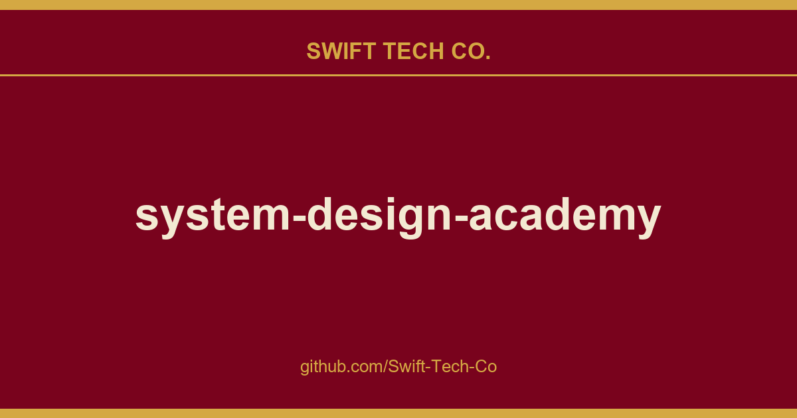

# system-design-academy

## What This Is

A practical reference entry for product and engineering: the system-design-academy notes, examples and fixes we reach for repeatedly. Kept current as part of the wider Swift Tech Co. engineering library.

## Images

## System Design Case Study

#### \# companies

- Real-Time Gaming Leaderboard
- Real-Time Live Comments
- Distributed Counter
- Real Time Presence Platform
- How Virtual Machines Work

#### A companies

- How to Scale an App to 10 Million Users on AWS
- This Is How Airbnb Adopted HTTP Streaming to Save 84 Million USD in Costs
- Amazon Prime Video Microservices Top Failure
- How Amazon S3 Achieves 99.999999999% Durability
- How Amazon Lambda Works
- How Amazon S3 Works
- How Do Apple AirTags Work
- How Apple Pay Handles 41 Million Transactions a Day Securely
- How Amazon S3 Achieves Strong Consistency

#### B companies

- Bitly URL Shortener Architecture
- How Does Bluesky Work

#### C companies

- How Canva Supports Real-Time Collaboration for 135 Million Monthly Users
- How Cloudflare Was Able to Support 55 Million Requests per Second With Only 15 Postgres Clusters

#### D companies

- How Disney+ Hotstar Delivered 5 Billion Emojis in Real Time
- How Disney+ Hotstar Scaled to 25 Million Concurrent Users
- How Disney+ Scaled to 11 Million Users on Launch Day
- How Telegram Boosts Performance With Code-Splitting
- How Dropbox Scaled to 100 Thousand Users in a Year After Launch

#### F companies

- How Facebook Scaled Live Video to a Billion Users
- How Facebook Was Able to Support a Billion Users via Software Load Balancer
- How Figma Scaled Postgres to 4M Users

#### G companies

- How Google Search Works
- How Giphy Delivers 10 Billion GIFs a Day to 1 Billion Users
- How to Scale an App to 100 Million Users on GCP
- How Google Docs Works

#### H companies

- How Hashnode Generates Feed at Scale
- How Halo Scaled to 11.6 Million Users Using the Saga Design Pattern

#### I companies

#### K companies

- How Khan Academy Scaled to 30 Million Users

#### L companies

- How LinkedIn Scaled to 930 Million Users
- How LinkedIn Adopted Protocol Buffers to Reduce Latency by 60%
- Tech Stack Evolution at Levels fyi
- How Lyft Support Rides to 21 Million Users

#### M companies

- How McDonald’s Food Delivery Platform Handles 20,000 Orders per Second
- How Meta Achieves 99.99999999% Cache Consistency

#### N companies

- How Does Netflix Work?
- Microservices Lessons From Netflix
- How Netflix Uses Chaos Engineering to Create Resilience Systems

#### P companies

- Pastebin
- Designing a Payment Backend with Stripe Integration

#### Q companies

- This Is How Quora Shards MySQL to Handle 13+ Terabytes

#### R companies

- How Razorpay Scaled to Handle Flash Sales at 1500 Requests per Second
- How Reddit Works

#### S companies

- Slack Architecture
- Virtual Waiting Room Architecture That Handles High-Demand Ticket Sales at SeatGeek
- How Shopify Handles Flash Sales at 32 Million Requests per Minute
- This Is How Stripe Does Rate Limiting to Build Scalable APIs
- How Stripe Prevents Double Payment Using Idempotent API

#### T companies

- Tumblr Shares Database Migration Strategy With 60+ Billion Rows
- 6 Proven Guidelines on Open Sourcing From Tumblr
- How Tinder Scaled to 1.6 Billion Swipes per Day

#### U companies

- How Uber Computes ETA at Half a Million Requests per Second
- How Uber Finds Nearby Drivers at 1 Million Requests per Second
- How Uber Payment System Handles 30 Million Transactions Per Day

#### W companies

- 8 Reasons Why WhatsApp Was Able to Support 50 Billion Messages a Day With Only 32 Engineers
- Wechat Architecture That Powers 1.67 Billion Monthly Users

#### Y companies

- 11 Reasons Why YouTube Was Able to Support 100 Million Video Views a Day With Only 9 Engineers
- How YouTube Was Able to Support 2.49 Billion Users With MySQL

#### Z companies

- 5 Reasons Why Zoom Was Able to Support 300 Million Video Calls a Day
- How Zapier Automates Billions of Tasks

---

## System Design Fundamentals

#### \# technologies

- Back of the Envelope
- How to Troubleshoot if You Can’t Access a Particular Website?
- What Happens When You Type a URL Into Your Browser?
- System Design Interview Cheat Sheet
- Software Engineer Interview Learning Resources
- 7 Simple Ways to Fail System Design Interview
- Amazon Frugal Architecture Explained
- 11 System Design Concepts Explained, Simply
- 114 System Design Concepts - Part 1
- 114 System Design Concepts - Part 2
- 114 System Design Concepts - Part 3
- How Timsort Algorithm Works
- Mobile System Design Concepts - Part 1
- Mobile System Design Concepts - Part 2
- Mobile System Design Concepts - Part 3

#### A technologies

- Actor Model
- How API Gateway Works
- API Gateway vs Load Balancer vs Reverse Proxy
- Best Practices for API Design
- Best Practices for API Security
- API Versioning
- High Performance APIs
- API Testing Techniques - Part 1
- API Testing Techniques - Part 2
- API Design Concepts - Part 1
- API Design Concepts - Part 2

#### B technologies

- Bloom Filter

#### C technologies

- Cell Based Architecture
- Consistency Patterns
- Top 5 Caching Patterns
- How to Scale Code Reviews
- Code Review Best Practices
- How Telegram Boosts Performance With Code-Splitting
- Consistent Hashing
- Concurrency Is Not Parallelism
- 15 Pitfalls That Break Cloud Systems
- Cybersecurity Terms Every Software Engineer Must Know
- The Entire Computer Science Stack, Explained In 51 Images
- How CDN Works
- How CI/CD Works

#### D technologies

- How Databases Keep Passwords Securely
- How DNS Works
- Deployment Patterns
- Distributed Systems Deep Dive
- How Docker Works
- 16 Database Types

#### F technologies
- 21 Frontend System Design Concepts for Software Engineers

#### G technologies

- Gossip Protocol
- 21 Git Commands

#### H technologies

- Hinted Handoff
- How Does HTTPS Work
- Must Know HTTP Headers
- What Is High Availability

#### J technologies

- How JWT Works

#### K technologies

- How Kafka Works
- How Kubernetes Works

#### L technologies

- How Load Balancing Algorithms Work

#### M technologies

- Micro Frontends
- Microservices Lessons From Netflix
- How Shopify Handled 30TB per Minute With a Modular Monolith Architecture
- 1 Simple Technique to Scale Microservices Architecture
- How Message Queues Work
- 22 Microservices Design Patterns

#### N technologies

- How Nginx Was Able to Support 1 Million Concurrent Connections on a Single Server

#### P technologies

- Forward proxy vs Reverse proxy
- 10 System Design Patterns

#### Q technologies

- Quotient Filter

#### R technologies

- Redis Use Cases
- Rate Limiting Strategies Explained
- How Remote Procedure Call Works

#### S technologies

- Service Discovery
- How Sidecar Pattern Works
- Stacked Diffs, Simply Explained
- How Stock Exchange Works - Part 1
- How Stock Exchange Handles Concurrency at Scale - Part 2
- Design Stock Exchange: A Deep Dive - Part 3

#### T technologies
- 50 System Design Tradeoffs

#### W technologies

- How Do Websockets Work
- How Do Webhooks Work

---

## System Design Interview

#### \# interviews

- System Design Interview Framework
- Behavioral Interview Playbook
- Mobile System Design Interview Framework

#### A interview
- System Design Interview: Design Airbnb

#### C interview
- System Design Interview: Design ChatGPT

#### R interview
- Software Engineer Resume

#### S interview
- System Design Interview: Design Spotify
- System Design Interview: Design Web Crawler and Search Engine
- System Design Interview: Design Amazon S3

#### T interview

#### W interview
- Design WhatsApp, Part 2

#### Y interview
- Design YouTube

---

## AI Engineering

#### A ai

- How AI Agents Work
- How to design your own AI agent
- 11 AI Concepts Explained, Simply
- Agentic AI Use Cases in Software Development Workflow
- 30 Agentic Engineering Concepts, Explained Simply
- How Agent to Agent Protocol Works
- 64 AI Concepts - Part 1

#### C ai

- AI Coding Workflow
- What is Context Engineering?
- Context Engineering vs Prompt Engineering
- How ChatGPT Apps Work
- Design a personal AI chat assistant
- Claude Folder - A Deep Dive
- Claude Code - Part 1
- Claude Code - Part 2
- Claude Code - Part 3
- Claude Code - Part 4

#### D ai
- Agentic Design Patterns
- How to Build a Domain Expert AI

#### E ai
- 29 LLM Evaluation Concepts
- AI Evals, Guardrails and Security

#### F ai
- How Fine Tuning Works

#### G ai
- Everything You Need to Know to Design GenAI Systems From Scratch
- AI Agent - Graph Shaped Memory

#### I ai
- What is AI Infrastructure
- How to Build AI Agents That Don’t Start Over When They Fail

#### K ai
- Design Knowledge Q&A System

#### L ai

- LLM Concepts, Simply Explained
- LLM as a Judge

#### M ai

- MCP - A Deep Dive
- Multi-Agent Architectures, Clearly Explained
- How ML Systems Actually Work: From Data to Deployment
- AI Agents: State, Memory, Consistency

#### N ai

- How to use NotebookLM

#### O ai

- How OpenClaw Works

#### P ai

- Prompt Engineering - A Deep Dive

#### R ai

- What Is Reinforcement Learning
- How RAG Works
- How AI Research Agent Works
- How Realtime AI Agent Works

#### S ai  
- Spec driven development for AI agents

#### V ai

- Vector Database - A Deep Dive
- Vertical Small LLM
- How Vector Database Search Billions of Vectors in Milliseconds

---

## Software White Papers

#### D white papers

- Amazon Dynamo

#### S white papers

- Google Spanner

#### X white papers

- Meta Serverless Architecture: XFaaS

---

  

   👋
   <a href="https://github.com/Swift-Tech-Co/system-design-academy">
     <b> Join Newsletter Now </b>
   </a>
 

---

## License

Licensed under <a href="https://github.com/Swift-Tech-Co/system-design-academy" target="_blank" rel="license noopener noreferrer" style="display:inline-block;">CC BY-NC-ND 4.0

---

## Swift Tech Co.

Built and maintained by Swift Tech Co.

AI Automation | FinTech Platforms | Custom Software and Mobile Apps | SaaS Platforms | Cloud Infrastructure | Cybersecurity | SEO and Marketing | API Integration

**Join our community on Telegram:** [t.me/+Qt_eFvkb2rliMzNh](https://t.me/+Qt_eFvkb2rliMzNh)

Home | Services | Careers | Referral Program | Influencers | About | Contact

**Connect**

- Website: https://github.com/Swift-Tech-Co/system-design-academy
- LinkedIn: [linkedin.com/in/stephenoladoke](https://www.linkedin.com/in/stephenoladoke/)
- LinkedIn (Company): [linkedin.com/company/swift-tech-co](https://www.linkedin.com/company/swift-tech-co)
- X: [@MrOladoke](https://x.com/MrOladoke)
- Instagram: [@mr.oladoke](https://www.instagram.com/mr.oladoke/)
- Organization: [github.com/Swift-Tech-Co](https://github.com/Swift-Tech-Co)

## Sources

Compiled and maintained from upstream [systemdesign42/system-design-academy](https://github.com/systemdesign42/system-design-academy) under permissive open-source license.

---

Maintained by [Swift Tech Co.](https://github.com/Swift-Tech-Co) - [Telegram](https://t.me/+Qt_eFvkb2rliMzNh)

## Sources

Compiled and maintained from upstream [systemdesign42/system-design-academy](https://github.com/systemdesign42/system-design-academy) under permissive open-source license.

---

Maintained by [Swift Tech Co.](https://github.com/Swift-Tech-Co) - [Telegram](https://t.me/+Qt_eFvkb2rliMzNh)

## Sources

Compiled and maintained from upstream [systemdesign42/system-design-academy](https://github.com/systemdesign42/system-design-academy) under permissive open-source license.

---

Maintained by [Swift Tech Co.](https://github.com/Swift-Tech-Co) - [Telegram](https://t.me/+Qt_eFvkb2rliMzNh)